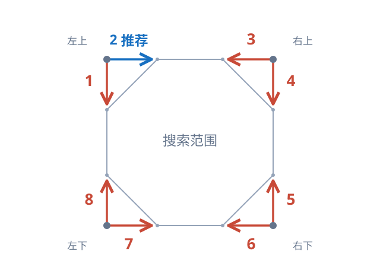

# 多点找色扫描方向

适用于 Android、Windows 的 `findColors`、`findColorsAll`，以及取色器生成这些命令时的方向参数。

**没有特定查找顺序要求时，建议使用方向 `2`。** 接口仍需显式传入 `dir`；取色器当前初始选择为 `1`，可手动改为 `2`。

四角的大圆点表示搜索起点，每个角对应两种扫描顺序；小圆点标示八边形的八个顶点。沿边箭头表示从该角出发的首行或首列扫描方向；扫描完后，按下表换到下一行或下一列，同一方向继续扫描，直到覆盖搜索区域。

| `dir` | 起点 | 扫描顺序 |
|---|---|---|
| `1` | 左上 | 每列向下，再向右换列 |
| `2`（推荐） | 左上 | 每行向右，再向下换行 |
| `3` | 右上 | 每行向左，再向下换行 |
| `4` | 右上 | 每列向下，再向左换列 |
| `5` | 右下 | 每列向上，再向左换列 |
| `6` | 右下 | 每行向左，再向上换行 |
| `7` | 左下 | 每行向右，再向上换行 |
| `8` | 左下 | 每列向上，再向右换列 |

`findColors` 返回按该顺序遇到的第一个完整匹配，`findColorsAll` 按该顺序排列全部命中。因此方向决定优先从哪个位置找到目标，多个位置都匹配时，改变方向可能改变首个返回结果。

方向 `2` 按行连续读取截图像素，适合作为常用选择；方向 `1` 在 Windows 上按列跨行读取，在 Android 上需要准备转置点阵，同一截图可以复用。实际耗时还取决于搜索范围、目标位置和截图是否复用，不保证固定的加速倍数。
